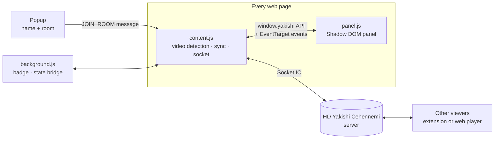

# 🔥 HD Yakishi Cehennemi for Chrome

**Watch any video on any website together, in sync.**

A Chrome extension (Manifest V3) that turns the video player on almost any site into a shared watch party. It adds a floating panel with synced controls, chat, live cursors, drawing and reactions on top of the page, and connects to the same real-time server as the [HD Yakishi Cehennemi web player](https://github.com/Yexsea/HDYakishiCehennemi).


<!-- DEMO-BASLANGIC  (video eklerken bu satırı ve aşağıdaki DEMO-BITIS satırını sil)
## ▶ Demo

VIDEO_LINKI_BURAYA

*Real recording of two Chrome windows with the extension on a sample video page: joining from the popup, syncing the site's own player, Alt + → seeking, chat, reactions and the different-page warning. Demo film: [Big Buck Bunny](https://peach.blender.org/) (CC BY 3.0, © Blender Foundation).*
DEMO-BITIS -->

---

## What it does

1. Open a page with a video and click the extension icon.
2. Enter your name and a room name, then press join.
3. Your friends do the same on the same page.
4. From now on, play, pause and seek on any one browser is mirrored on all the others, and a panel appears on the page for chat, reactions, cursors and drawing.

The site's own player keeps working as usual. The extension listens to it and controls it, so you can use either the site's buttons or the panel.

## Highlights

- **Works on most sites** with an HTML5 `<video>` player, including single-page apps that change videos without reloading
- **Finds the right video**: when a page has several videos, it picks the largest one and keeps watching the page for new ones
- **Same-page check**: if your friends are on a different URL, you get a warning showing who is where
- **Doesn't break the page**: the panel lives in a closed Shadow DOM, so the site's CSS can't touch it and it can't touch the site
- **Remembers you**: your name, room and connection state are saved, so after a page reload it reconnects automatically
- **Safe chat rendering**: messages are HTML-escaped before display
- **Volume boost** up to 200% through the Web Audio API

## The panel

| Area | What's in it |
|---|---|
| Header | Connection status, minimize button; the whole panel can be dragged anywhere |
| Users | Who is in the room right now |
| Controls | Play/pause, −5 s / +5 s, current time / duration, volume slider with percentage |
| Modes | Share your mouse cursor, draw on top of the video |
| Chat | Messages, typing indicator, unread badge while minimized |
| Reactions | ❤️ 😂 😲 👏 🔥 floating emojis, plus a secret combo |
| Alerts | Toast notifications, a warning when you're on a different page, a banner when someone disconnects |

**Shortcuts:** `Alt + Space` play/pause, `Alt + ←` / `Alt + →` seek 5 seconds. The `Alt` modifier keeps them from clashing with the site's own shortcuts.

## How it works



- **`content.js`** is the core. It finds the main `<video>` element, attaches play/pause/seek listeners, keeps a Socket.IO connection to the server and applies incoming sync events. An `isSyncing` flag prevents echo loops, where applying a remote pause would send a new pause back.
- **Video detection** uses a `MutationObserver` for videos that load after the page, and checks the URL every second to support single-page sites. When the URL changes it reports the new page to the server and looks for the video again.
- **`panel.js`** builds the floating UI inside a closed Shadow DOM and talks to the core only through a small public API (`window.yakishi`) and custom events. The UI and the networking logic stay independent of each other.
- **`background.js`** is the MV3 service worker. It shows a ✓ badge while connected and passes state between the popup and the active tab.
- **`popup.html` / `popup.js`** handle joining and leaving, with simple validation, and store the session in `chrome.storage`.
- A **heartbeat** every 25 seconds keeps the room membership alive. Drawing strokes and cursor positions are sent relative to the video's size, so they line up on different screens; cursor updates are throttled to 20 per second.

## Install (developer mode)

1. Download or clone this repository.
2. Open `chrome://extensions` and turn on **Developer mode** (top right).
3. Click **Load unpacked** and select the repository folder.
4. Pin the extension, open a page with a video and click the icon.

The extension connects to the hosted server. The server runs on a free hosting tier, so the first connection after a quiet period can take a little while. To use your own server, run the [server](https://github.com/Yexsea/HDYakishiCehennemi) and change `SERVER_URL` at the top of `content.js`.

### Permissions

| Permission | Why |
|---|---|
| `storage` | Remember your name, room and whether you were connected |
| `activeTab` | Talk to the tab you're on from the popup |
| Content script on all URLs | Find and control the video on whichever site you open |

The extension only connects to the server after you join a room.

## Files

```
├── manifest.json      # MV3 manifest
├── content.js         # Core: video detection, sync, socket, drawing, cursors, URL tracking
├── panel.js           # Floating panel UI (Shadow DOM)
├── panel.css          # Panel styles, loaded inside the shadow root
├── popup.html/.js     # Join / leave popup
├── background.js      # Service worker: badge and state bridge
├── socket.io.min.js   # Socket.IO client library
└── simgecik.png       # Icon
```

The interface text is in Turkish.

## Roadmap

- [ ] Inject the scripts on demand with `chrome.scripting` instead of on every page
- [ ] Resize the icon to the standard 16/48/128 px set to shrink the package
- [ ] Jump late joiners straight to the room's current position
- [ ] Publish on the Chrome Web Store
